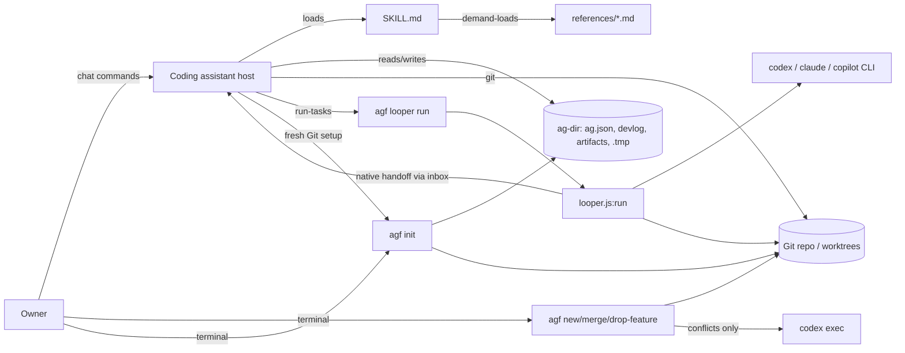

# Architecture

## Two halves

1. **Prompt-defined workflow (host-driven).** Everything except the Node runtime below is instructions that a coding-assistant host executes with its own tools (file edits, Git). There are explicitly no hooks, daemons or helper scripts for ordinary work (`references/configuration.md` first paragraph, `references/session.md#notebook-ownership` last item).
2. **Node runtime (`agf`).** Three narrow, explicitly scoped exceptions sharing one launcher (`scripts/agf.js`; listed in `SKILL.md#load-only-the-applicable-procedure` Looper bullet):
   - **Looper**: a coordinator that runs prepared task groups in isolated Git worktrees and integrates them — `agf looper run|status|cleanup` (`references/looper.md#shell-entry--alphabetical`).
   - **Terminal feature CLI** (9.1.0): `agf new-feature|merge-feature|drop-feature` plus `agf shell` — the feature-worktree lifecycle run from a terminal instead of host chat (`references/features.md#terminal-cli`). It does not reuse the looper coordinator.
   - **Standalone initializer** (9.1.2): `agf init [--lang <locale>]` — deterministic fresh-Git setup scaffold (`references/setup.md#standalone-initialization`). Hosts call it for supported fresh Git setup but keep routing, claims, capture, binding and delivery duties.

## Prompt layer

- **Entrypoint**: `skills/agentflow/SKILL.md`. Sections:
  - `#route-before-records` — strict precedence: (1) off-record markers, (2) isolated looper task, (3) configuration/routing, (4) feature lifecycle, (5) retained `.init-pending.owner` recovery, then fresh setup or idle shortcut, (6) owned work.
  - `#load-only-the-applicable-procedure` — which reference to load per situation. Design goal: keep the default load small (CHANGELOG 9.0.0-beta.1).
- **Procedure references** (`skills/agentflow/references/`), each owning one concern:

| Reference | Owns |
| --- | --- |
| `configuration.md` | ag.json discovery/validation, switches, release-check scheduling |
| `session.md` | claim/ownership, recovery, owner-input capture, project rules/backlog, round evidence |
| `delivery.md` | STATUS/Ask/Reply rendering, receipt, archive, Git delivery, rename |
| `work.md` | task modes, execution, RUN/WIP, diffs |
| `planning.md` | design/tracker creation, plan-mode, gates |
| `review.md` | worker settings, delegation, planning routes, result review, `3ways` |
| `simple-check.md` | `simple-check` command (fresh independent read-only plan review → PASS/REVISE/BLOCKED) and the canonical `#check` that `planning.md` and `review.md` apply without adding stages (9.1.2) |
| `batches.md` | `append-rounds` staging/advancement |
| `features.md` | feature worktree lifecycle and handoffs; `#terminal-cli` / `#terminal-directory-transition` for the `agf` feature commands |
| `looper.md` | looper contract (authoritative for runtime behavior) |
| `setup.md` | first-time setup, AGENTS.md adoption in consumer projects, `#agf-command-setup` (generated `agf` shell function), `#detected-worker-defaults` (looper routes from detected `codex`/`claude`), `#empty-bootstrap` (one empty commit for repos without HEAD), `#standalone-initialization` (`agf init` contract and `.init-pending.owner` recovery) |
| `upkeep.md`, `legacy-migration.md` | schema migration, Agentflow 8 migration, install replacement |
| `invariants.md`, `project-rules.md` | system-invariant registry, shared project rules |
| `ag.md` + `advisors/*.md` | optional advisor selection and prompts |
| `copilot.md`, `windows.md`, `browser-testing.md`, `browfield.md`, `product-docs.md`, `product-docs-authoring.md`, `writing.md`, `saving-mode.md` | situational guidance |

- **Human docs** (`skills/agentflow/docs/`: `AG-GUIDE.md`/`AG-GUIDE.tw.md`, `CHEATSHEET.md`/`CHEATSHEET.tw.md`, `agv8-agv9-comparison.md`) and READMEs restate behavior for users. `references/looper.md#scope-and-maintenance` requires SKILL.md, configuration, review, both guides, cheatsheet and README to stay aligned when looper behavior changes.

## Persistence (consumer project, prompt layer)

All state is plain files written by the host, under the configured `ag-dir` (default `.agentflow`):

| File | Purpose | Template |
| --- | --- | --- |
| `<ag-dir>/ag.json` | settings, schema 13 (`switches.saving-mode` required) | `assets/.agentflow/ag.json` |
| `<ag-dir>/<notebook-name>` | devlog: STATUS + append-only Ask/Reply rounds | `assets/.agentflow/devlog.md` |
| `.<notebook>.owner` beside notebook | session claim JSON `{session, ask, claimed_at}` created with `wx` | — |
| `<ag-dir>/backlog.md`, `<ag-dir>/sys-invariants.md`, optional `<ag-dir>/rules.md` | shared records | assets |
| `<ag-dir>/artifacts/A-NNN/` | designs, trackers, reports for an Ask | — |
| `<ag-dir>/.tmp/A-NNN.md` | durable workflow evidence (despite the name) | — |
| `<notebook-stem>.archive.md` | archived rounds when notebook > 750 lines | — |
| `<ag-dir>/features/<name>/<name>.devlog.md` | feature notebook inside `.wts/ft-<name>` | — |
| `<ag-dir>/features/<name>/{merge,snapshot,intake}-state.json`, `.merge-*` workspace | feature CLI merge recovery state (written only by `agf merge-feature`) | — |
| `.agentflow/.init-pending.owner` → `.git/agf-init-completed-<uuid>.json` | `agf init` reservation/interruption marker; renamed into `.git/` only after verified completion, retained on any failure | — |

## Looper runtime

Modules in `skills/agentflow/scripts/` (dependency direction: `agf.js → {looper, looper-report}`, lazily `looper-cleanup`, `init` and the feature modules; `looper.js → {looper-integration, looper-agent, looper-state}`, lazily `looper-report` (status) and `looper-cleanup` (cleaned queues); `looper-cleanup → {looper-state, looper-integration, looper-agent, looper}`; `looper-integration` and `looper-agent` both use `looper-state`; `looper-integration.js:git` lazily requires `looper-agent.js:resolve_command` on Windows).

| Module | Responsibility | Key symbols |
| --- | --- | --- |
| `agf.js` | argv parsing and dispatch (init / looper / feature / shell), locale lookup, progress observer + 30 s heartbeat, `--cleanup` sequencing, report save, exit codes | `main` |
| `looper.js` | coordinator loop, queue validation, settings discovery/selection, native handoff, answers import, task job, ordinary-review relay, integration loop, target adoption calls, status | `run`, `status`, `validate`, `read_settings`, `select`, `worker`, `notebook_rounds`, `ordinary_closeout`, `ordinary_review_proof`, `project_context`, `contract_changes`, `task_text` |
| `looper-integration.js` | all Git mutations; hooks disabled via `core.hooksPath` | `git`, `prepare_group`, `commit_task`, `target_safe`, `target_identity`, `adopt_target`, `landing_applied`, `prepare_integration`, `verify_integration`, `commit_repair`, `land`, `no_operation`, `changed`, `scoped` |
| `looper-agent.js` | spawn processes with identity tracking, descendants, timeouts; build CLI args per provider; parse results; save `failure.json`; run checks; Windows command resolution | `launch_agent`, `execute`, `run_checks`, `resolve_command`, `shim_entry`, `observe_descendants`, `validate_result`, `result_schema`, `parse_claude_result`, `parse_copilot_result`, `copilot_environment`, `provider_error`, `diagnostic_text` |
| `looper-cleanup.js` | explicit cleanup of a completed run: holds queue/target claims, journals intent in `queue.cleanup`, moves worktrees/run-root extras to macOS Trash, unregisters exact worktrees, keeps branches | `cleanup`, `assert_completed` |
| `looper-report.js` | presentation only: progress/heartbeat lines, final summary, `results.md` and `evidence/run-<time>-<uuid>.txt`, en/zh-TW strings; never affects scheduling or exit codes | `observer`, `summary`, `details`, `save_report`, `dictionary`, `resolve_locale`, `terminal_text` |
| `looper-state.js` | safe path checks (no symlink/escape), atomic `write_json`, exclusive claims, process identity (Linux `/proc`, Windows CIM via PowerShell, `ps lstart` elsewhere) | `safe_path`, `inspect_path`, `write_json`, `read_json`, `acquire_claim`, `verify_claim`, `release_claim`, `takeover_claim`, `process_identity`, `process_alive`, `writer_stopped` |

### Looper persistence (run-root = `<ag-dir>/artifacts/A-NNN-<name>/planned/`)

- `queue.json` (schema 2) — single source of truth for scheduling, progress, attempts, questions, handoffs, integration; written only by the coordinator through `save()` inside `looper.js:run`, which verifies both claims and that the file was not changed externally.
- `request.md` + `request_sha256`, `group-NNN.md` (task sections `## T01`).
- `inputs/`, `attempts/<uuid>/` (prompt, schema, launch, transcript, exit, result, process, descendants; `failure.json` on launch/execution/result failure; `ordinary-reviews/<request-id>/` for relayed task reviews), `evidence/` (check logs, `run-<time>-<uuid>.txt` run reports), `inbox/` (native results `<uuid>.json`, `answers.json`), `results.md` (generated, hash-bound report).
- `queue.json` also records `target_adoptions[]` (forward target advances) and, after explicit cleanup, `cleanup` (journal of moves/unregistrations; the run-root then keeps only queue/request/group plans).
- `.queue.owner` claim; target claim `aglite-target-<hash>.owner` in the Git common dir. Released claims are renamed `*.released-<uuid>`, never deleted.
- Group worktrees: `<repo>/.wts/aglite-<run_id>-<group>` on branch `aglite-<run_id>-<group>`; integration worktrees `<repo>/.wts/aglite-merge-<run_id>-<group>-<uuid>`. Task notebooks in `<worktree>/.aglite-records/` (git-excluded, never integrated); CLI tasks request ordinary review through `<worktree>/.aglite-records/ordinary-review/<attempt-id>/request.json`.
- These `aglite`-prefixed names are retained runtime identifiers; the 9.0.0 rename to `agentflow` deliberately left them unchanged.

### Concurrency model

- One coordinator per queue and per target branch (exclusive claims with process identity; takeover only if all recorded writers are proved stopped).
- Up to `looper-limits.max-workers` (default 3) groups running tasks; tasks inside a group run sequentially.
- One serial integration lane (FIFO `ready` list, ties broken by group ID); at most one repair may overlap task work.
- `depends_on` groups wait (no slot) until predecessors reach `state: done` (checked integration).
- Target movement (9.1.0): `looper-integration.js:adopt_target` records a same-branch forward advance in `target_adoptions` and moves `expected_head` (at startup, workspace dispatch, integration start/observation, before landing, on races). Branch change, history rewrite, a foreign Git operation, or a completed integration missing from the target throws → `lane_error`. A checked result whose base was superseded is carried into a new merge attempt on the latest head with checks rerun.
- Ordinary review relay: a CLI task writes a review request into its records; the coordinator launches a fresh read-only sibling session via `invoke('review')` (role `review` maps to the `acceptance` route in `select`), binds request/source hashes (`ordinary_review_proof`) and settles it before the task slot and claims release.

## Feature CLI runtime

Separate from the looper; only the `agf` launcher and some helpers are shared.

| Module | Responsibility | Key symbols |
| --- | --- | --- |
| `feature.js` | `new-feature` (worktree add, notebook scaffold/resume, inherited config copy, optional `--open` editor) and `drop-feature` | `create`, `drop`, `scaffold`, `resumePreparation` |
| `feature-merge.js` | `merge-feature`: snapshot/commit named dirty paths (`--include`), scoped candidate via temporary index + `merge-tree --write-tree`, `codex exec` conflict resolver, checks (10 min each), CAS `update-ref`, retirement records, optional cleanup, auto-commit/auto-push; resumable via `merge-state.json` phases | `merge` |
| `feature-common.js` | context/identity (main = primary registered worktree, `.wts/ft-<name>`, `feature/<name>`), canonical config discovery without migration, UUID claims, Trash preflight/disposal, `retire` | `context`, `discover`, `claim`, `retire`, `preflightTrash`, `localLifecycleConfig` |
| `feature-shell.js` | generated zsh/bash/PowerShell `agf` function; `AGF_CD_FILE` destination channel validation/writes | `binding`, `channel`, `destination` |

Dependencies: `feature.js → {feature-common, feature-shell, looper-report}`; `feature-merge.js → {feature-common, feature-shell, looper-report, looper-agent:execute, looper-state:process_alive}`; `feature-common → looper-state` (and `looper-report` for locale support). Generated records support English and Traditional Chinese only; other locales stop before mutation. Platform: macOS uses Trash; Windows deletes the exact checkout/claims directly (best effort); Linux refuses record operations (`feature-common.js:preflightClaimDisposal`).

## Initializer runtime (9.1.2)

| Module | Responsibility | Key symbols |
| --- | --- | --- |
| `init.js` | `agf init`: verify/initialize the physical Git root, skip complete setups, reserve `.agentflow/` exclusively, empty bootstrap, scaffold config/notebook/backlog/registry/placeholders, adopt AGENTS directives (en/zh-TW), detect `codex`/`claude` routes, commit only generated paths, retire the marker | `initialize`, `locale` (internal: `repository`, `complete`, `scan`, `preflight`, `detect`, `instructions`, `adopt`) |

Dependencies: `init.js → {feature-common (discover, git with hooks disabled, noOperation, roundHeadings), looper-state (checked_file, powershell)}`. Always uses the default ag-dir `.agentflow`. Never migrates, repairs, pushes, writes shell profiles or calls models; partial/legacy/ambiguous state is left for host reconciliation.

## External systems

| System | Used by | Where |
| --- | --- | --- |
| Git | features (host and feature CLI), looper, initializer | `references/features.md`, `feature-merge.js`, `looper-integration.js`, `init.js` |
| `codex exec` | looper CLI route; external review on a Claude host; feature CLI conflict resolver | `looper-agent.js:launch_agent`, `feature-merge.js:merge`, `references/review.md#external-cli-examples--authorized-planningreview` |
| `claude -p` | looper CLI route; external planning/review | same |
| `codex --version` / `claude --version` | initializer route detection only (no model call; skipped on Windows) | `init.js:detect` |
| `copilot` CLI | looper CLI route | `looper-agent.js:launch_agent`, `references/copilot.md` |
| GitHub releases `agfnow/agentflow` | release check by host every 2 days | `references/configuration.md#session-release-check` |
| Browserbase `browse` / Stagehand | default browser-test tooling | `references/browser-testing.md` |
| OS Trash/Recycle Bin | reversible worktree removal (host); macOS `/usr/bin/trash` for looper cleanup and feature CLI | `references/features.md#retire-one-worktree`, `references/windows.md#reversible-cleanup`, `looper-cleanup.js`, `feature-common.js` |
| Editor (`default-editor`, default `code`) | `agf new-feature --open` | `feature.js:create` |

## Authority and authorization model

There is no user authentication. "Authorization" means owner authority recorded in chat/notebook:

- Settings never grant authority; they only select behavior for already-authorized work (repeated across `configuration.md`, `review.md`).
- Notebook claims coordinate cooperating agent sessions, not security (`session.md#notebook-ownership`).
- Looper `queue.json` `authorization.{execute,worktrees,local_commits}` must be `true` (`looper.js:validate`), but the docs state the booleans themselves grant nothing.
- Spawned agents are constrained by CLI flags (sandbox/read-only/tool allowlists); docs explicitly say these are not OS containment.
