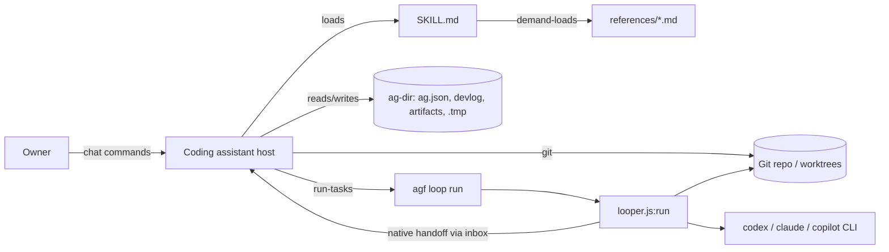

# Architecture

## Two halves

1. **Prompt-defined workflow (host-driven).** Everything except the looper is instructions that a coding-assistant host executes with its own tools (file edits, Git). There are explicitly no hooks, daemons or helper scripts for ordinary work (`references/configuration.md` first paragraph, `references/session.md#notebook-ownership` last item).
2. **Looper runtime (Node.js).** A narrow, explicitly scoped exception: a coordinator that runs prepared task groups in isolated Git worktrees and integrates them. Only `agf loop run` and `agf loop status` exist (`references/looper.md#shell-entry--alphabetical`).

## Prompt layer

- **Entrypoint**: `skills/aglite/SKILL.md`. Sections:
  - `#route-before-records` — strict precedence: (1) off-record markers, (2) isolated looper task, (3) configuration/routing, (4) feature lifecycle, (5) fresh setup or idle shortcut, (6) owned work.
  - `#load-only-the-applicable-procedure` — which reference to load per situation. Design goal: keep the default load small (CHANGELOG 9.0.0-beta.1).
- **Procedure references** (`skills/aglite/references/`), each owning one concern:

| Reference | Owns |
| --- | --- |
| `configuration.md` | ag.json discovery/validation, switches, release-check scheduling |
| `session.md` | claim/ownership, recovery, owner-input capture, project rules/backlog, round evidence |
| `delivery.md` | STATUS/Ask/Reply rendering, receipt, archive, Git delivery, rename |
| `work.md` | task modes, execution, RUN/WIP, diffs |
| `planning.md` | design/tracker creation, plan-mode, gates |
| `review.md` | worker settings, delegation, planning routes, result review, `3ways` |
| `batches.md` | `append-rounds` staging/advancement |
| `features.md` | feature worktree lifecycle and handoffs |
| `looper.md` | looper contract (authoritative for runtime behavior) |
| `setup.md` | first-time setup, AGENTS.md adoption in consumer projects |
| `upkeep.md`, `legacy-migration.md` | schema migration, Agentflow 8 migration, install replacement |
| `invariants.md`, `project-rules.md` | system-invariant registry, shared project rules |
| `ag.md` + `advisors/*.md` | optional advisor selection and prompts |
| `copilot.md`, `windows.md`, `browser-testing.md`, `browfield.md`, `product-docs.md`, `writing.md`, `saving-mode.md` | situational guidance |

- **Human docs** (`skills/aglite/docs/`) and READMEs restate behavior for users. `references/looper.md#scope-and-maintenance` requires SKILL.md, configuration, review, both guides, cheatsheet and README to stay aligned when looper behavior changes.

## Persistence (consumer project, prompt layer)

All state is plain files written by the host, under the configured `ag-dir` (default `.agentflow`):

| File | Purpose | Template |
| --- | --- | --- |
| `<ag-dir>/ag.json` | settings, schema 12 | `assets/.agentflow/ag.json` |
| `<ag-dir>/<notebook-name>` | devlog: STATUS + append-only Ask/Reply rounds | `assets/.agentflow/devlog.md` |
| `.<notebook>.owner` beside notebook | session claim JSON `{session, ask, claimed_at}` created with `wx` | — |
| `<ag-dir>/backlog.md`, `<ag-dir>/sys-invariants.md`, optional `<ag-dir>/rules.md` | shared records | assets |
| `<ag-dir>/artifacts/A-NNN/` | designs, trackers, reports for an Ask | — |
| `<ag-dir>/.tmp/A-NNN.md` | durable workflow evidence (despite the name) | — |
| `<notebook-stem>.archive.md` | archived rounds when notebook > 750 lines | — |
| `<ag-dir>/features/<name>/<name>.devlog.md` | feature notebook inside `.wts/ft-<name>` | — |

## Looper runtime

Modules in `skills/aglite/scripts/` (dependency direction: `agf.js → looper.js → {looper-integration, looper-agent, looper-state}`; `looper-integration` and `looper-agent` both use `looper-state`; `looper-integration.js:git` lazily requires `looper-agent.js:resolve_command` on Windows).

| Module | Responsibility | Key symbols |
| --- | --- | --- |
| `agf.js` | argv parsing, exit codes | — |
| `looper.js` | coordinator loop, queue validation, settings discovery/selection, native handoff, answers import, task job, integration loop, status | `run`, `status`, `validate`, `read_settings`, `select`, `worker`, `counterpart`, `notebook_rounds`, `ordinary_closeout`, `project_context`, `task_text` |
| `looper-integration.js` | all Git mutations; hooks disabled via `core.hooksPath` | `git`, `prepare_group`, `commit_task`, `target_safe`, `prepare_integration`, `verify_integration`, `commit_repair`, `land`, `no_operation`, `changed`, `scoped` |
| `looper-agent.js` | spawn processes with identity tracking, descendants, timeouts; build CLI args per provider; parse results; run checks; Windows command resolution | `launch_agent`, `execute`, `run_checks`, `resolve_command`, `shim_entry`, `observe_descendants`, `validate_result`, `result_schema`, `parse_claude_result`, `parse_copilot_result`, `copilot_environment` |
| `looper-state.js` | safe path checks (no symlink/escape), atomic `write_json`, exclusive claims, process identity (Linux `/proc`, Windows CIM via PowerShell, `ps lstart` elsewhere) | `safe_path`, `inspect_path`, `write_json`, `read_json`, `acquire_claim`, `verify_claim`, `release_claim`, `takeover_claim`, `process_identity`, `process_alive`, `writer_stopped` |

### Looper persistence (run-root = `<ag-dir>/artifacts/A-NNN-<name>/planned/`)

- `queue.json` (schema 2) — single source of truth for scheduling, progress, attempts, questions, handoffs, integration; written only by the coordinator through `save()` inside `looper.js:run`, which verifies both claims and that the file was not changed externally.
- `request.md` + `request_sha256`, `group-NNN.md` (task sections `## T01`).
- `inputs/`, `attempts/<uuid>/` (prompt, schema, launch, transcript, exit, result, process, descendants), `evidence/` (check logs), `inbox/` (native results `<uuid>.json`, `answers.json`).
- `.queue.owner` claim; target claim `aglite-target-<hash>.owner` in the Git common dir. Released claims are renamed `*.released-<uuid>`, never deleted.
- Group worktrees: `<repo>/.wts/aglite-<run_id>-<group>` on branch `aglite-<run_id>-<group>`; integration worktrees `<repo>/.wts/aglite-merge-<run_id>-<group>-<uuid>`. Task notebooks in `<worktree>/.aglite-records/` (git-excluded, never integrated).

### Concurrency model

- One coordinator per queue and per target branch (exclusive claims with process identity; takeover only if all recorded writers are proved stopped).
- Up to `looper-limits.max-workers` (default 3) groups running tasks; tasks inside a group run sequentially.
- One serial integration lane (FIFO `ready` list, ties broken by group ID); at most one repair may overlap task work.
- `depends_on` groups wait (no slot) until predecessors reach `state: done` (checked integration).

## External systems

| System | Used by | Where |
| --- | --- | --- |
| Git | features (host), looper | `references/features.md`, `looper-integration.js` |
| `codex exec` | looper CLI route; external review on a Claude host | `looper-agent.js:launch_agent`, `references/review.md#external-cli-examples--authorized-planningreview` |
| `claude -p` | looper CLI route; external planning/review | same |
| `copilot` CLI | looper CLI route | `looper-agent.js:launch_agent`, `references/copilot.md` |
| GitHub releases `agfnow/agentflow` | release check by host every 2 days | `references/configuration.md#session-release-check` |
| Browserbase `browse` / Stagehand | default browser-test tooling | `references/browser-testing.md` |
| OS Trash/Recycle Bin | reversible worktree removal | `references/features.md#retire-one-worktree`, `references/windows.md#reversible-cleanup` |

## Authority and authorization model

There is no user authentication. "Authorization" means owner authority recorded in chat/notebook:

- Settings never grant authority; they only select behavior for already-authorized work (repeated across `configuration.md`, `review.md`).
- Notebook claims coordinate cooperating agent sessions, not security (`session.md#notebook-ownership`).
- Looper `queue.json` `authorization.{execute,worktrees,local_commits}` must be `true` (`looper.js:validate`), but the docs state the booleans themselves grant nothing.
- Spawned agents are constrained by CLI flags (sandbox/read-only/tool allowlists); docs explicitly say these are not OS containment.
